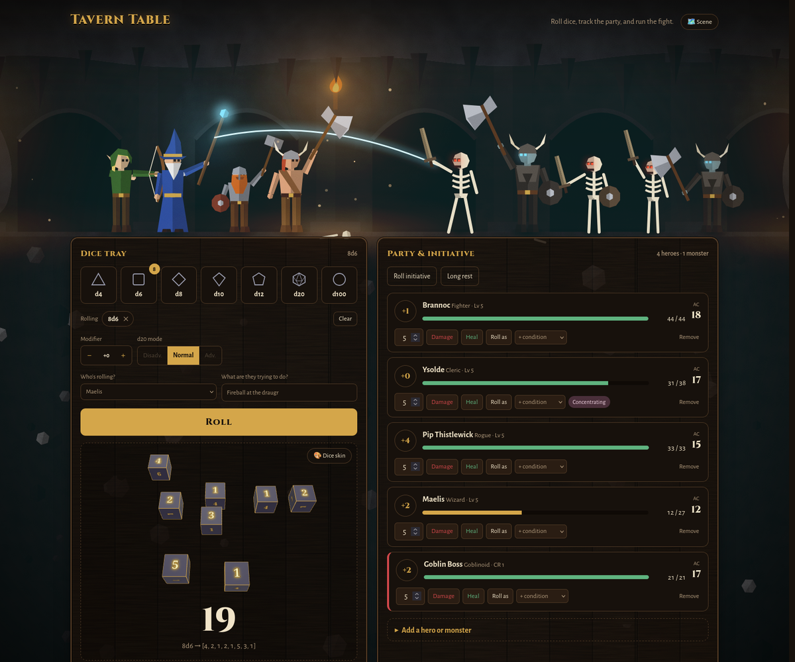
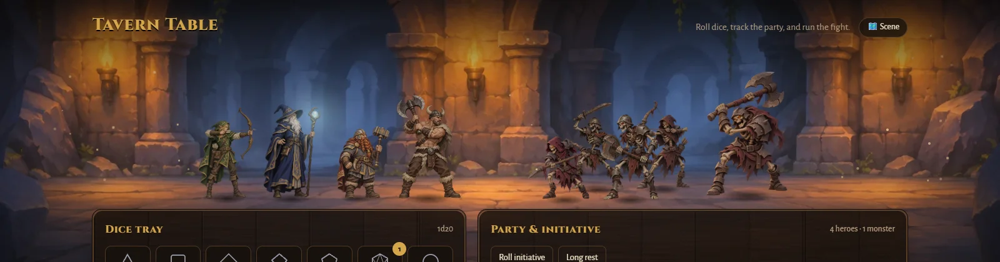

<div align="center">

# 🍺 Tavern Table 🎲

**Pull up a chair, grab your dice, and let's roll.**

A torchlit dice tray and party tracker for tabletop RPG nights, built for 5th-edition style games.




</div>

---

## 🚪 Getting started

1. Open `index.html` in any modern browser.
2. There is no step 2. 🎉

Keep the whole folder together: the page loads its styles and scripts from the `css` and `js` folders next to it.

No install, no build step, no account. The page does need an internet connection, because it loads the 3D library ([Three.js](https://threejs.org)) and its fonts from the web.

> 🛠️ **Tinkering with the code?** The [Live Server](https://marketplace.visualstudio.com/items?itemName=ritwickdey.LiveServer) extension for VS Code reloads the page every time you save.

---

## ✨ What's on the table

### 🎲 Real 3D dice
Click **Roll** and watch them go. The dice are tossed onto the table, bounce, tumble over each other, crash off the walls and settle flat, and **the number facing up is the number you rolled.** When they land, each rolled number lights up in a yellow glow and pops up so you can read it at a glance. With advantage or disadvantage, only the d20 you keep lights up.

| Die | How it reads |
|---|---|
| d6, d8, d10, d12, d20 | The number on the top face |
| d4 | The number at the corner pointing up, just like a real d4 |
| d100 | A round ball that rolls to a stop with the result facing you |

Roll up to **20 dice at once**, and mix any types you like: 2d6 + 1d8 for a sneak attack, 8d6 for a Fireball. They shrink to fit and bump into each other on the way.

### 🗺️ Scenes
Click **Scene** at the top to set the mood. The scene fills the whole page behind the dice tray and party, with the party in the middle of the action at the top and the ground running down behind the (slightly see-through) wooden panels:

| Scene | What's happening |
|---|---|
| 🍺 Tavern | The party shares a round by the fire |
| 💀 Dungeon | Skeletons and draugr block the tunnel |
| 🐉 Dragon's Cave | A dragon crawls out of the mountain |
| 🏘️ Town Square | Market day, with shops and townsfolk |
| 🔥 Wizard's Tower | A dark wizard rains fireballs on the party |
| 👑 Castle | The king knights the heroes |

Every scene has real depth and atmosphere:
- **Layers** that shift slightly as you move the mouse, with distant things fading into haze
- **Real light**: torches, fires, lamps, windows and magic flicker and light up the stone, wood and ground around them
- **Life**: drifting dust and embers, twinkling stars, clouds rolling by, banners swaying, and fireballs flying from the wizard's tower
- **Soft shadows** under everyone, and a color mood for each place

If your computer is set to *reduce motion*, the scenes hold still.

Your choice is saved.

### 🧪 In the works: painted art
The scenes are getting a painted high-fantasy makeover, and the first one is ready to try: pick **Dungeon (Painted)** from the Scene menu.



It sits *next to* the original Dungeon while it's being tested, so the six original scenes stay exactly as they are. The characters' poses are placeholders for now. Final art is on the way, then the other five scenes.

### 🎨 Dice skins
Click **Dice skin** in the corner of the dice table to pick from 40 skins: classics, gemstones, metals, camo (woodland, desert, arctic, digital and more), marble, wood and cosmic. Or use **Make your own** to pick colors, a pattern and a finish. Your choice is saved.

### 🧮 The dice tray
- Tap a die to add it to the roll. Tap it again for more. Tap a die in the *Rolling* row to take one away, or **Clear** to start over.
- Add a modifier from **−10 to +30**.
- **Advantage and disadvantage** roll two d20s; the one you drop is crossed out.
- **Natural 20s** glow gold. **Natural 1s** glow red. 😬
- Say who's rolling and what they're trying (*"Pick the lock on the crypt door"*), and it goes in the log.

### ⚔️ Party and initiative
- Track every hero and monster's **HP, AC, level or CR** and **initiative modifier**.
- Deal damage or heal. HP bars go green, then gold, then red, and anyone at 0 HP is marked **Down**.
- Add conditions like *Poisoned*, *Prone* or *Concentrating*, and click a condition to clear it.
- **Roll initiative** for everyone at once, then step through turns and rounds.
- **Roll as** loads a character's initiative modifier straight into the dice tray.
- **Long rest** brings the heroes back to full HP and clears their conditions. Monsters get no such luck. 🐉

### 📜 Roll log
The last 40 rolls: when, who, what they were attempting, and how it went.

---

## 💾 Saving

Your party, the current fight and the roll log are saved in your browser, so they survive a refresh.

- Your data stays on your device. It's never sent anywhere.
- Opening the file directly and opening it through Live Server count as different sites, so each keeps its own save.
- Clearing your browser's site data resets the table to the sample party.

---

## 🔮 How the dice work (for the curious)

When you click **Roll**, the result is decided first, using fair random numbers. Then:

1. **The whole roll is simulated instantly**: tosses, gravity, bounces, collisions and tumbling, all recorded step by step.
2. **The numbers are quietly rearranged** on each die, so the face that ends up on top shows what you actually rolled.
3. **The recording plays back** over two seconds.

So the dice look completely natural, and they always agree with the result. No loaded dice here.

---

## 🗺️ The road ahead

- 🎨 **Painted art for every scene**: the painted Dungeon is in testing; final character poses and the other five scenes are next
- 🔄 **Scenes that follow the story**, switching on their own as the adventure moves from tavern to dungeon
- ⚡ **Saved roll presets**, like *Longsword 1d8+3* or *Fireball 8d6*
- 🧾 **Typed formulas**, like `2d6+1d4+3`
- 💀 **Death saving throws** for characters at 0 HP
- 📋 **Fuller character sheets** with ability scores and saving throws

**Play together online** (planned)
- 🌍 **A hosted site**: play at a web address in any browser, with nothing to download
- 👤 **Accounts**: sign in to keep your characters, dice skins and roll history on every device
- 📊 **Stats**: nat 20s and nat 1s, your luckiest and unluckiest rolls, averages per character
- 🧑‍🤝‍🧑 **Shared parties**: invite friends with a link, see everyone's rolls live, and let the DM run turn order
- 🔒 **Fair rolls in multiplayer**: rolled by the server, so nobody can fudge a nat 20

---

## 📁 What's in the box

```
index.html             The page itself: markup, plus the list of styles and scripts to load
css/style.css          Layout and components (tray, party cards, log, skin menu)
css/tavern.css         The theme: colors and the wooden panels
css/scenes.css         The full-page scene and the scene menu
css/scenekit.css       Scene kit: depth layers, lights, particles, overlays
js/noise.js            Seeded random numbers and tiling noise (for skins and scenes)
js/storage.js          Saving and loading (and upgrading old saves)
js/app.js              The party & initiative, roll log
js/tray.js             Dice pool, modifier, advantage, the Roll button
js/skins.js            The 40 dice skins, pattern painter and skin menu
js/figures.js          The party, monsters, townsfolk and props, drawn as low-poly SVG
js/scenekit.js         Scene kit: tools for scenes with depth, light and atmosphere
js/scenes.js           The six scenes and the scene menu
js/dice3d.js           The 3D dice: shapes, numbers, physics, rolling, glow
docs/screenshot.png    The picture at the top of this page
assets/                     Painted art for the scenes and characters (web-size WebP)
docs/painted-preview.webp   The painted Dungeon preview
README.md              You are here
```

<div align="center">

*May your rolls be high and your fumbles be funny.* 🎲

</div>
